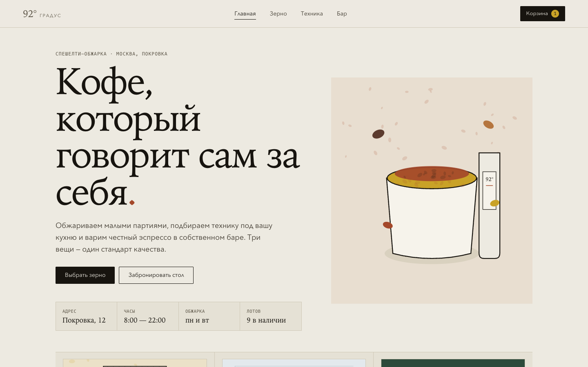

# 92° — премиальный магазин specialty coffee

Один сайт на три направления: **зерно** собственной обжарки, **кофейная техника** и **кофейня**. Полноценный интернет-магазин на статике — без сборки и зависимостей.

**Открыть:** двойной клик по `index.html` (или отдать папку на любой статический хостинг).



## Что внутри

| Раздел | Маршрут | Что показывает |
|---|---|---|
| Главная | `#/` | редакционный hero, три направления, зерно недели, техника, бар, контакты |
| Зерно | `#/beans` | 9 лотов: страна, регион, высота, обработка, профиль вкуса, обжарка, дата, вес, цена |
| Техника | `#/tech` | 10 товаров в 3 категориях (кофемашины / кофемолки / аксессуары) со статусом наличия |
| Товар | `#/product/:id` | полная карточка зерна или техники |
| Бар | `#/bar` | меню на трёх вкладках, атмосфера, бронь, адрес и часы |
| Оформление | `#/checkout` | форма заказа и подтверждение (демо) |

**Работает:** фильтр обжарки, сортировка по цене/популярности, категории техники, корзина (± / удаление / итог / localStorage), оформление с подтверждением, бронь столика, клавиатурная навигация по табам.

## Дизайн

Бренд «92°» — температура заваривания. Сохранена editorial-айдентика: бумага `#EDEAE1`, чернила `#17140F`, терракота `#A4482A`, сталь `#2F4858`, лес `#2C4A3B`; серифные заголовки против моноширинных данных, тонкие линейки вместо теней и скруглений.

- **Изображения** — локальные параметрические SVG-иллюстрации (`images.js`): у каждого лота свой пакет с этикеткой по происхождению, у техники — технический чертёж, у бара — напитки и интерьер. Без сетевых зависимостей и случайных фото.
- **Три разных структуры** — зерно как витрина упаковок, техника как холодный шоурум, бар как атмосферная витрина.
- **Движение** — одно оркестрованное появление представления, деликатные hover; `prefers-reduced-motion` уважается.

## Структура

```
index.html      оболочка: шапка, <main id="app">, корзина, тост, подвал
styles.css      дизайн-система и адаптив (1440 → 375px)
app.js          данные каталога, роутер (hash), корзина, фильтры, сортировка, бронь, checkout
images.js       генератор SVG-изображений
screenshots/    снимки Desktop и Mobile
```

## Как менять

- **Товары** — массивы `BEANS` и `TECH` в начале `app.js`; меню бара — `MENU`.
- **Цвета и шрифты** — переменные в `:root` в `styles.css`.
- **Изображения** — функции `Images.*` в `images.js`.

## Что это демо, а не магазин

Нет бэкенда: заказ и бронь никуда не уходят, показывается подтверждение на клиенте. Нет оплаты, остатков, авторизации. Цены, адрес и названия выдуманы.

## Проверка

Снято и проверено в реальном Chrome через Playwright:

- десктоп 1440 и 1280, планшет 768, мобильные 390 и 375 — горизонтальной прокрутки нет (`scrollWidth = clientWidth`) на всех маршрутах;
- 0 ошибок в консоли;
- сценарии: добавление → счётчик/сумма, изменение количества, удаление, фильтр «светлая» → 4 лота, сортировка по цене, категории техники, блокировка soldout, бронь, полный checkout с подтверждением;
- контраст текста ≥ 4.5:1 (AA).
